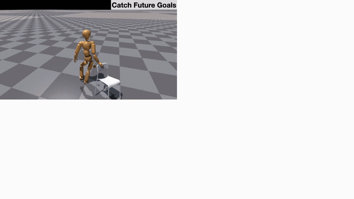

<h1 align="center"><strong>InterPrior: Scaling Generative Control for Physics-Based Human-Object Interactions</strong></h1>

<p align="center">
  <a href="https://sirui-xu.github.io/">Sirui Xu</a>,
  <a href="https://samschulter.github.io/">Samuel Schulter</a>,
  <a href="https://scholar.google.com/citations?user=wkYZMakAAAAJ&amp;hl=en">Morteza Ziyadi</a>,
  <a href="https://xialin-he.github.io/">Xialin He</a>,
  <a href="http://feixh.github.io/">Xiaohan Fei</a>,<br>
  <a href="https://yxw.cs.illinois.edu/">Yu-Xiong Wang</a>,
  <a href="https://lgui.cs.illinois.edu/">Liang-Yan Gui</a><br>
  University of Illinois Urbana-Champaign &nbsp; · &nbsp; Amazon<br>
  <strong>CVPR 2026 Highlight</strong>
</p>

<p align="center">
  <a href="https://arxiv.org/abs/2602.06035"></a>
  <a href="https://arxiv.org/pdf/2602.06035"></a>
  <a href="https://sirui-xu.github.io/InterPrior/"></a>
</p>

## 🏠 Overview

<div align="center">
  
</div>

InterPrior cultivates motor intuition with a versatile skillset, executing sparse goals for object interaction while coordinated loco-manipulation behavior emerges naturally.

[▶ Watch the full teaser](https://sirui-xu.github.io/InterPrior/static/videos/teaser_720p.mp4) · [Project page](https://sirui-xu.github.io/InterPrior/)

## 📖 Getting Started

### Dependencies

Use the **same Isaac Gym environment as [InterMimic](https://github.com/Sirui-Xu/InterMimic#dependencies)**: Python 3.8, PyTorch, Isaac Gym Preview 4, and the InterMimic dependencies. If that environment is already installed:

```bash
conda activate intermimic-gym
export LD_LIBRARY_PATH="$CONDA_PREFIX/lib${LD_LIBRARY_PATH:+:$LD_LIBRARY_PATH}"
python -m pip install -e . --no-deps
```

For a new installation, follow InterMimic's environment instructions and install the dependencies in [requirement.txt](requirement.txt). Run the following commands from this repository's root directory.

### Data and Assets

The SMPL policy uses the **OMOMO subset of InterAct**, processed and corrected through InterMimic's teacher rollouts. Use the [prepared data released by InterMimic](https://drive.google.com/file/d/1l2E5qR97Ap8jrLrJPHmtNT8DDW1qKhY_/view?usp=sharing) and extract the motion `.pt` files into:

```text
InterAct/OMOMO_retarget/
```

These are the prepared SMPL motion tensors used for student inference. The raw OMOMO files have a different representation.

Reuse the humanoid and object assets from InterMimic:

```bash
git clone --depth 1 https://github.com/Sirui-Xu/InterMimic.git external/InterMimic
```

The default asset location is `external/InterMimic/isaacgym/src/intermimic/data/assets`. To use an existing checkout, pass `--intermimic-root /path/to/InterMimic`. A small set of prepared motions is also included in that checkout at `InterAct/OMOMO_retarget/`, so the quick start below works with the public examples.

### Pretrained Policy

Download the [InterPrior SMPL checkpoint](https://github.com/Sirui-Xu/InterPrior/releases/latest/download/interprior_smpl.pth) to the location below, or use the [complete inference bundle](https://github.com/Sirui-Xu/InterPrior/releases/latest/download/interprior-inference.zip), which includes code and the checkpoint:

```text
checkpoints/interprior_smpl.pth
```

The checkpoint contains the policy and its observation normalization statistics. Keep it at the location above, or select it with `--checkpoint`.

## 🎮 Reference Sparse Goal Tracking

Track sparse human joint positions and/or the object center from a reference motion:

```bash
sh scripts/test_interprior.sh --num-envs 1 \
  --motion-dir external/InterMimic/InterAct/OMOMO_retarget \
  --motion-file sub2_largetable_000.pt \
  --goal-mode combined --show-goals
```

Choose `--goal-mode human`, `object`, or `combined` (default). Human goals use the head and wrists; `--joints` selects up to three reference joints. For a fixed reference pose, add `--task snapshot --goal-frame 96`.

`--show-goals` displays targets as Isaac Gym spheres. Add `--headless` to run without a viewer. See [examples and video recording](examples/README.md) for more options.

## 🔗 Citation

If you find this work useful, please cite:

```bibtex
@inproceedings{xu2026interprior,
  title={InterPrior: Scaling Generative Control for Physics-Based Human-Object Interactions},
  author={Xu, Sirui and Schulter, Samuel and Ziyadi, Morteza and He, Xialin and Fei, Xiaohan and Wang, Yu-Xiong and Gui, Liang-Yan},
  booktitle={CVPR},
  year={2026}
}
```

For the prepared motions and simulation foundation, please also cite [InterMimic](https://github.com/Sirui-Xu/InterMimic#-citation), [InterAct](https://github.com/wzyabcas/InterAct), and [OMOMO](https://github.com/lijiaman/omomo_release).

## 👏 Acknowledgements and 📚 License

Built on [InterMimic](https://github.com/Sirui-Xu/InterMimic) and [InterAct](https://github.com/wzyabcas/InterAct).

InterPrior code is released under the [MIT License](LICENSE). External SDKs, motion data, model weights, and character assets retain their respective terms.
